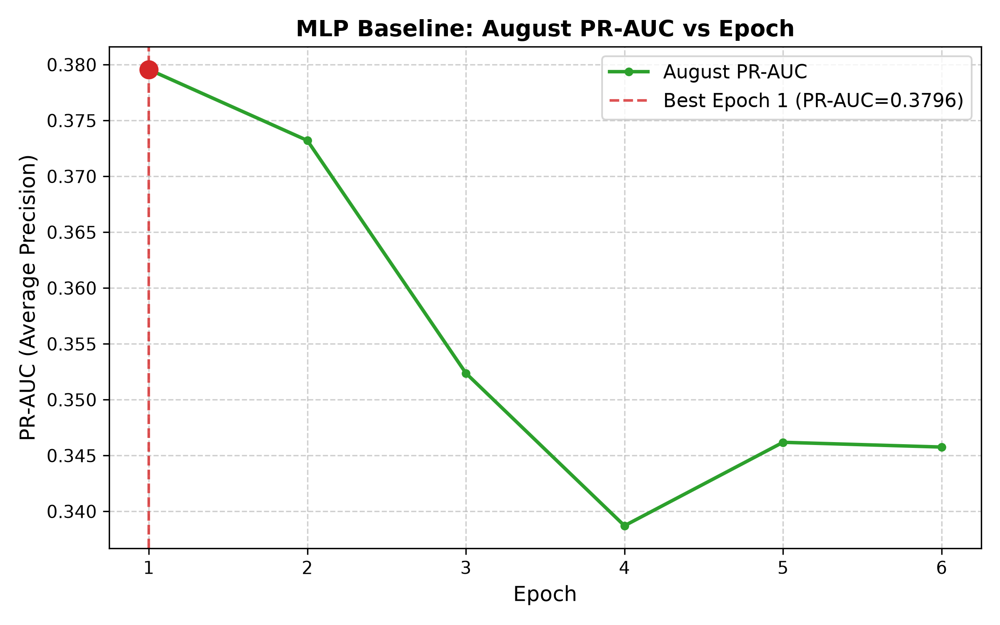

# Phase 2 — Member 1: Simple MLP Baseline for Flight Delay Prediction

## Executive Summary

As part of Phase 2 (Deep Learning), Member 1 implemented the **Simple Feed-Forward Multi-Layer Perceptron (MLP) Baseline** using PyTorch and One-Hot Encoding. This model establishes the baseline neural network architecture for binary flight-delay prediction, serving as the benchmark against which recurrent architectures (Member 2's GRU) and entity-embedding architectures (Member 3's embedding MLP) will be evaluated.

The target task is predicting whether a commercial flight departing a New York City airport will experience an arrival delay of at least 15 minutes (`is_delayed = 1 if arr_delay >= 15 else 0`), utilizing **strictly pre-departure information** available at the decision cutoff of end-of-day $D-1$.

---

## 1. Problem Formulation & Rationale for MLP

Flight delay prediction is framed as a supervised binary classification problem:

$$\hat{y} = P(Y = 1 \mid \mathbf{x}) \in [0, 1]$$

where $\mathbf{x} \in \mathbb{R}^{D}$ represents the feature vector known before departure, and $Y \in \{0, 1\}$ indicates whether the arrival delay equals or exceeds 15 minutes.

### Why MLP is Appropriate
1. **Non-linear Feature Interactions**: Tabular flight data exhibits complex multi-way interactions (e.g., origin congestion interacting non-linearly with scheduled departure hour and carrier delay propensities). Whereas linear models (Logistic Regression) require manual polynomial feature construction, multi-layer feed-forward networks learn non-linear representations through compositions of affine transformations and non-linear activation functions.
2. **Dense Gradient-Based Baseline**: A standard fully connected MLP provides an established deep learning reference point that directly consumes high-dimensional one-hot representations without sequence assumptions or specialized embedding lookup tables.
3. **Probabilistic Output**: The network outputs a probability through a sigmoid. As with the Phase 1 models, these raw probabilities still need checking and, if used for decisions, post-hoc calibration (Section 5).

---

## 2. Feature Preprocessing & Transformation Pipeline

The Phase 1 feature engineering pipeline produces 59 engineered features:
* **49 Numerical Features**: Calendar features (sin/cos cyclic encodings, holiday distance), schedule/route metrics (scheduled departure/arrival minute, scheduled block minutes, distance, log-distance), congestion counts (origin/hour density, carrier share), and historical delay rates across past rolling windows (1d, 7d, 28d, and expanding all-past rates smoothed with a Bayesian prior of strength $m=20$).
* **10 Categorical Features**: High-cardinality and interaction categories (`carrier`, `origin`, `dest`, `route`, `dep_bucket`, `carrier_origin`, `carrier_dest`, `carrier_route`, `origin_dep_bucket`, `carrier_dep_bucket`).

### Preprocessing Strategy

```
Raw Features (49 Numeric, 10 Categorical)
                   │
                   ▼
┌────────────────────────────────────────────────────────┐
│ FeatureEncoder (Train Split Only, min_count=50)        │
│  - Numeric: Missing imputed with Training Median       │
│  - Categorical: Infrequent & unseen mapped to __OTHER__│
└──────────────────────────┬─────────────────────────────┘
                           │
             ┌─────────────┴─────────────┐
             ▼                           ▼
┌─────────────────────────┐ ┌─────────────────────────┐
│ StandardScaler (Train)  │ │ OneHotEncoder (Train)   │
│  - Mean centering (μ)   │ │  - handle_unknown=ignore│
│  - Unit variance (σ)    │ │  - Sparse to Float32    │
│  - Output: 49 dims      │ │  - Output: 966 dims     │
└────────────┬────────────┘ └────────────┬────────────┘
             └─────────────┬─────────────┘
                           ▼
          Concatenated Feature Vector: 1,015 Dims
```

1. **Rare-Level Collapsing (`FeatureEncoder`)**:
   - Levels with fewer than 50 occurrences in the training rows are collapsed to `__OTHER__`. The
     encoder, scaler and one-hot encoder are fitted separately for each training stage (January–July
     for epoch selection, January–August for the final model; Section 4), never on later data.
   - Any category level not seen in training is deterministically mapped to `__OTHER__`.
2. **Standardization of Numerical Features (`StandardScaler`)**:
   - Neural network weights are updated via gradient descent; disparities in feature scale (e.g., `distance` in thousands of miles versus `sched_dep_hour_frac` in $[0, 1]$) lead to ill-conditioned loss surfaces, erratic gradients, and slow convergence.
   - All 49 numerical features are centered to zero mean and scaled to unit variance:
     $$z = \frac{x - \mu_{\text{train}}}{\sigma_{\text{train}}}$$
   - Parameters $\mu_{\text{train}}$ and $\sigma_{\text{train}}$ are estimated **strictly from the training split**.
3. **One-Hot Encoding (`OneHotEncoder`)**:
   - Categorical levels are converted into binary indicator variables with `handle_unknown="ignore"`.
   - The 10 categorical columns expand into **966 binary indicator columns** for the final January–August fit (962 for the January–July fit).
4. **Input Dimension**:
   - The preprocessed input dimensionality is:
     $$D = 49 \text{ (numerical)} + 966 \text{ (one-hot)} = \mathbf{1,015} \text{ dimensions}$$
   - Preprocessed arrays are cast to `float32` (about 0.85 GB for the 217,727 January–August rows).

---

## 3. MLP Baseline Architecture

The neural network is implemented in `src/flight_delay/models/mlp.py` as `MLPBaseline(nn.Module)`.


### Mathematical Formulation

Given input vector $\mathbf{x} \in \mathbb{R}^{1015}$:

1. **Hidden Layer 1**:
   $$\mathbf{h}_1 = \text{ReLU}\left(\mathbf{W}_1 \mathbf{x} + \mathbf{b}_1\right), \quad \mathbf{W}_1 \in \mathbb{R}^{128 \times 1015}, \mathbf{b}_1 \in \mathbb{R}^{128}$$
   $$\tilde{\mathbf{h}}_1 = \text{Dropout}(\mathbf{h}_1, p = 0.3)$$

2. **Hidden Layer 2**:
   $$\mathbf{h}_2 = \text{ReLU}\left(\mathbf{W}_2 \tilde{\mathbf{h}}_1 + \mathbf{b}_2\right), \quad \mathbf{W}_2 \in \mathbb{R}^{64 \times 128}, \mathbf{b}_2 \in \mathbb{R}^{64}$$
   $$\tilde{\mathbf{h}}_2 = \text{Dropout}(\mathbf{h}_2, p = 0.2)$$

3. **Output Layer (Raw Logits)**:
   $$z = \mathbf{W}_3 \tilde{\mathbf{h}}_2 + b_3, \quad \mathbf{W}_3 \in \mathbb{R}^{1 \times 64}, b_3 \in \mathbb{R}$$

4. **Probability Prediction (Inference Only)**:
   $$P(\text{delay} \ge 15 \mid \mathbf{x}) = \sigma(z) = \frac{1}{1 + e^{-z}}$$

> **Important**: Sigmoid activation is intentionally **omitted** from the `forward()` method. Raw logits $z$ are output directly to maintain numerical stability during training with PyTorch's `nn.BCEWithLogitsLoss()`. Sigmoid is evaluated only during inference and probability evaluation.

### Components Rationale
* **ReLU Activation**: Mitigates vanishing gradient issues compared to sigmoid/tanh activations, enabling stable backpropagation through the network layers.
* **Dropout Regularization ($p_1 = 0.3, p_2 = 0.2$)**: Prevents co-adaptation of hidden feature detectors and mitigates overfitting on sparse one-hot features.
* **Progressive Dimension Reduction ($1015 \to 128 \to 64 \to 1$)**: Compresses high-dimensional sparse representations into dense representations before projecting to a single logit.

---

## 4. Training Protocol & Optimization

### Protocol (D-301): one job per period, as in Phase 1
| Period | Job |
|:---|:---|
| January–July 2013 (188,971 flights) | Fit the network (Stage A) |
| August 2013 (28,756 flights) | Early stopping: choose the number of epochs by August PR-AUC |
| January–August 2013 (217,727 flights) | Refit for exactly that many epochs, no early stopping (Stage B, the saved model) |
| September–October 2013 (55,628 flights) | Score once, next to the Phase 1 Logistic Regression on the same flights |
| November–December 2013 | Sealed; not read |

This is the same protocol as Phase 1 (D-201): no period is both used to make a choice and to
report a result. September–October is therefore an honest out-of-sample estimate for both models.

### Training Configuration
* **Framework**: PyTorch 2.15.0, trained on CPU (`--device cpu`, the default) so the run is reproducible; `cuda`/`mps` can be selected.
* **Optimizer**: Adam ($\beta_1 = 0.9, \beta_2 = 0.999, \epsilon = 10^{-8}$)
* **Learning Rate**: $0.001$
* **Batch Size**: 256
* **Maximum Epochs**: 30
* **Early Stopping**: Patience = 5 epochs, monitoring **August PR-AUC** (Average Precision)
* **Random Seed**: 42 (fixed seeds for Python `random`, `numpy`, and PyTorch generators)

### Loss Function & Class Imbalance Analysis
Binary Cross-Entropy with Logits loss:

$$\mathcal{L}_{\text{BCE}}(z, y) = - \left[ y \log \sigma(z) + (1 - y) \log (1 - \sigma(z)) \right]$$

The training target is imbalanced (January–August): 160,304 on-time and 57,423 delayed flights,
a positive rate of 0.2637 and an imbalance ratio of $160{,}304 / 57{,}423 \approx 2.79$.

#### `pos_weight` (not used)
Setting `pos_weight = 2.79` in `nn.BCEWithLogitsLoss` up-weights delayed flights. In an earlier
run (before D-301, selected on September–October, so indicative only) it barely changed PR-AUC
(0.2837 vs 0.2816) but pushed the mean predicted probability from 0.25 to 0.48 against a 0.157
delay rate (ECE 0.32 vs 0.10). Because PR-AUC depends only on the ranking, re-weighting gives no
ranking benefit and only distorts the probabilities, so the baseline is trained without it
(`use_pos_weight=False`).

---

## 5. Empirical Results & Evaluation

### Epoch selection on August (Stage A)
* Best epoch: **1** (August PR-AUC 0.3796, ROC-AUC 0.6668; August delay rate 0.246).
* Training loss falls every epoch ($0.524 \to 0.488$), while August loss rises from epoch 1
  ($0.542 \to 0.600$) and August PR-AUC falls: the network starts to overfit after one pass over
  the data. Early stopping halted training at **epoch 6**.
* For comparison, the Phase 1 models on the same August period scored PR-AUC 0.4007 (Logistic
  Regression) and 0.3960 (XGBoost), D-201.

| Epoch | Train BCE (Jan–Jul) | August BCE | August PR-AUC | August ROC-AUC | August Brier | August ECE | Note |
|:---:|:---:|:---:|:---:|:---:|:---:|:---:|:---:|
| **1** | **0.52416** | **0.54175** | **0.37957** | **0.66682** | **0.17775** | **0.05285** | **Selected** |
| 2 | 0.50935 | 0.55518 | 0.37321 | 0.66670 | 0.18529 | 0.07477 | |
| 3 | 0.50248 | 0.56335 | 0.35238 | 0.66046 | 0.18908 | 0.07470 | |
| 4 | 0.49736 | 0.57959 | 0.33872 | 0.65619 | 0.19603 | 0.08893 | |
| 5 | 0.49172 | 0.61123 | 0.34619 | 0.66515 | 0.20263 | 0.11449 | |
| 6 | 0.48771 | 0.59968 | 0.34576 | 0.66500 | 0.19780 | 0.10502 | Early stop |

The final model was then refit on January–August for 1 epoch (training loss 0.524).

### September–October results (scored once)

| Model (raw probabilities) | PR-AUC | ROC-AUC | Brier | ECE (10 bins) | Mean probability |
|:---|:---:|:---:|:---:|:---:|:---:|
| Logistic Regression (Phase 1 final, D-202) | **0.2896** | **0.6800** | 0.1855 | 0.2334 | 0.390 |
| Simple MLP baseline | 0.2773 | 0.6679 | **0.1344** | **0.0856** | 0.243 |

Delay rate: 0.157 (8,731 of 55,628 flights). Both models were trained on January–August and
neither was tuned on September–October.

**Reading of the results**
1. **Ranking: the MLP is slightly worse than Logistic Regression.** PR-AUC 0.277 against 0.290 and
   ROC-AUC 0.668 against 0.680. The same order holds on August (0.380 against 0.401). With these
   59 features, the extra non-linearity of the MLP does not help; the Phase 1 crosses already give
   Logistic Regression the main interactions. This matches Phase 1, where XGBoost also did not beat
   Logistic Regression.
2. **Calibration: better than raw Logistic Regression, but not well calibrated.** The MLP's
   raw probabilities are closer to the truth because it is trained without class weights, whereas
   the Phase 1 model uses `class_weight="balanced"`. They are still too high on average (0.243
   predicted against 0.157 observed; ECE 0.086), because September–October is calmer than the
   training months. Post-hoc calibration (Member 5) is still needed before any probability is used
   for decisions.
3. **Operating target:** precision 0.60 is reached only at the extreme top of the ranking
   (threshold 0.757, recall 0.0003, i.e. 3 of 8,731 delayed flights), so as in Phase 1 it is not
   a usable operating point.
4. **Overfitting after one epoch:** with 1,015 inputs, of which 966 are sparse one-hot columns,
   the first layer alone has about 130k weights. The best epoch being the first suggests the
   learning rate and capacity are too high for this data; tuning these (and replacing one-hot with
   embeddings) is Member 3's task.

### Diagnostic numbers at threshold 0.50 (not an operating point)
Precision 0.420, recall 0.084, F1 0.140. Confusion matrix [[TN, FP], [FN, TP]] =
[[45,886, 1,011], [7,999, 732]]. The 0.50 threshold is arbitrary; Phase 1 chose thresholds only
on October against the precision target (D-204), and the MLP has no such threshold.

---

## 6. Visualizations

All figures are saved in `reports/figures/phase2_member1/`:

### A. Training vs August Loss Curve

*Stage A: training loss on January–July against loss on the August tuning month.*

### B. August PR-AUC vs Epoch

*Epoch selection: August PR-AUC per epoch, with the selected epoch marked.*

### C. Confusion Matrix Heatmap

*Final model on September–October at the diagnostic 0.50 threshold.*

### D. Precision-Recall Curve

*Final model on September–October against the 0.157 delay rate.*

---

## 7. Comparison with Phase 1 and next steps

* Compared on the same flights and the same protocol (Section 5), the simple MLP ranks slightly
  worse than the Phase 1 Logistic Regression. It is the deep-learning reference that Members 2–4
  must beat; the Phase 1 Logistic Regression remains the overall reference.
* **Member 3** replaces the 966 sparse one-hot columns with learned embeddings and tunes layers,
  learning rate, batch size and dropout on August under the same D-301 protocol.
* **Member 2** adds ordered daily sequences (GRU) of past airport and carrier delays.
* **Member 4** measures what each feature group and embeddings contribute.
* **Member 5** compares all models on September–October with the same metrics and calibrates.

---

## 8. Artifacts & Reproducibility

```bash
python scripts/seal_holdout.py      # once: January-October development file
python scripts/train_mlp_baseline.py   # needs torch; refuses to overwrite existing outputs
```

### Saved Files in `models/phase2/member1/`:
* `mlp_baseline.pth`: PyTorch `state_dict` of the final model (January–August, 1 epoch).
* `mlp_preprocessor.joblib`: Serialized `MLPPreprocessor` (fitted `FeatureEncoder`, `StandardScaler` and `OneHotEncoder`, January–August).
* `feature_encoder.json`: The same `FeatureEncoder` state in JSON (rare-category mapping and training medians).
* `training_history.json`: Stage A epoch-by-epoch losses and August metrics, and the Stage B refit loss.
* `august_selection_metrics.json`: August metrics of the selected Stage A epoch.
* `validation_metrics.json`: Final model's metrics on September–October.
* `model_config.json`: Hyperparameters, layer dimensions, random seed (42), and device.
* `run_metadata.json`: Periods, row counts, feature lists, torch version and timestamp.

### Saved Results in `reports/results/phase2_member1/`:
* `validation_metrics.json`, `validation_metrics.csv`: September–October metrics of the MLP.
* `model_comparison.csv`: MLP and Phase 1 Logistic Regression on the same September–October flights.

### Programmatic Inference Example

```python
from flight_delay.models.mlp_training import predict_flight_delays
import pandas as pd

# Load new unencoded pre-departure features
flights_df = pd.read_parquet("data/processed/valid.parquet").head(10)  # September-October rows

# Run end-to-end inference using saved Phase 2 Member 1 artifacts
probabilities, predictions = predict_flight_delays(
    artifacts_dir="models/phase2/member1",
    df=flights_df,
    threshold=0.50,
    device="cpu",  # or "mps" / "cuda"
)

print("Predicted delay probabilities:", probabilities)
print("Predicted binary classes:", predictions)
```
