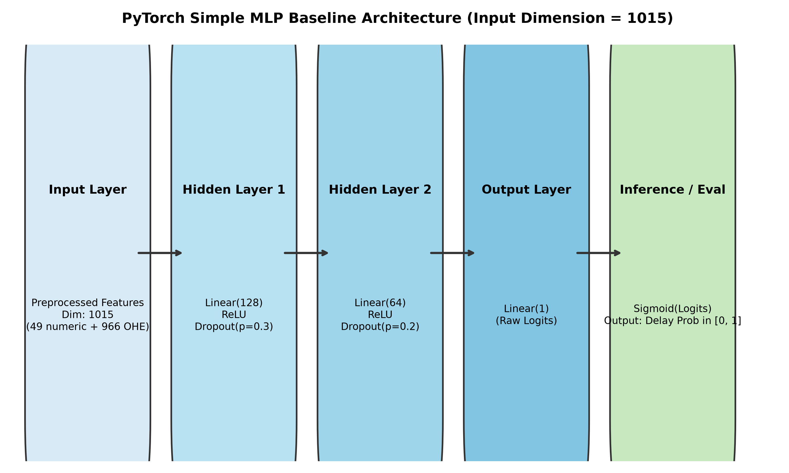
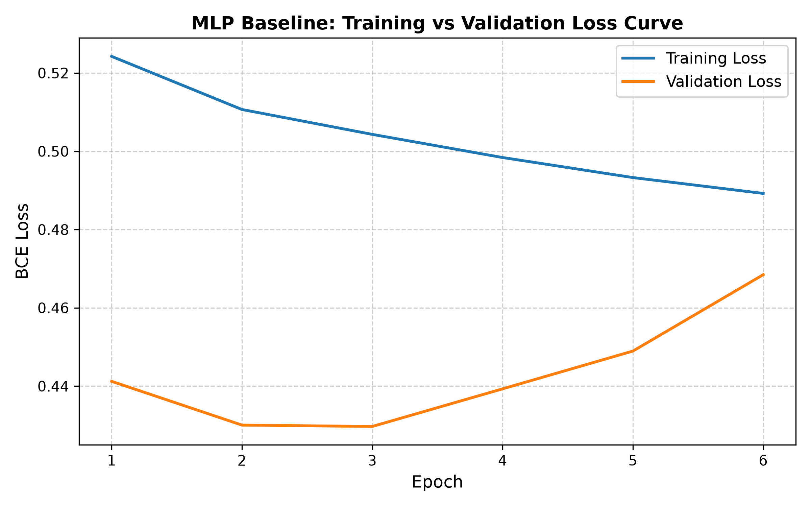
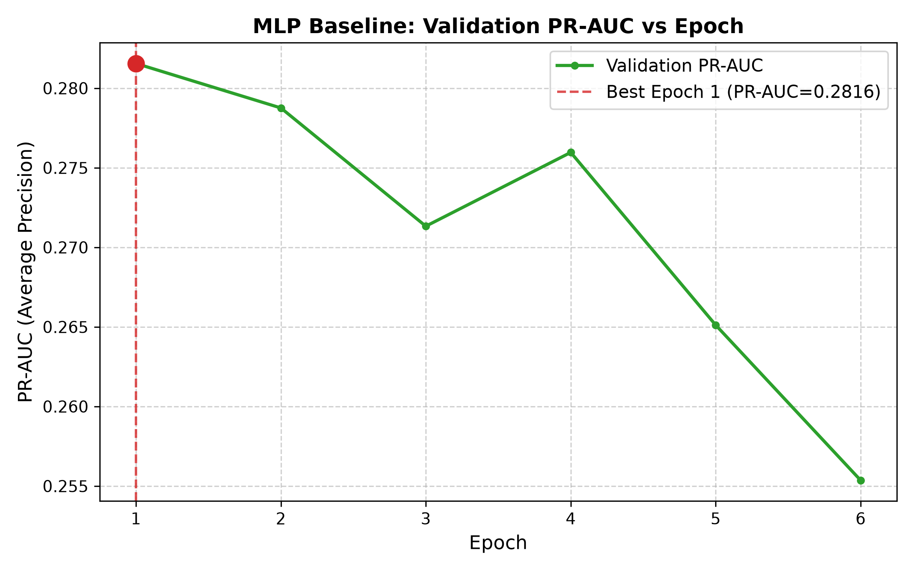
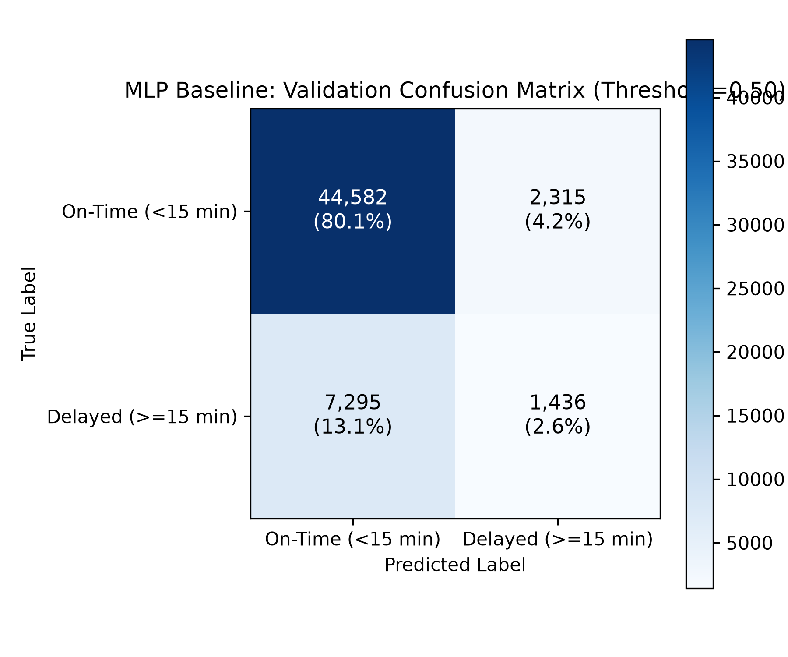
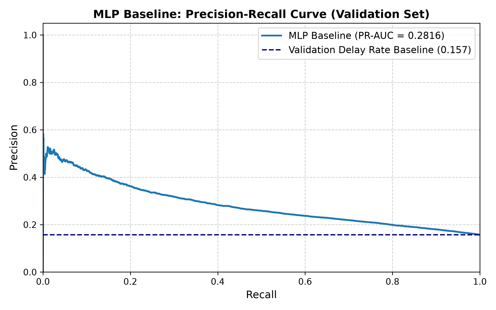

# Phase 2 — Member 1: Simple MLP Baseline for Flight Delay Prediction

## Executive Summary

As part of Phase 2 (Deep Learning), Member 1 implemented the **Simple Feed-Forward Multi-Layer Perceptron (MLP) Baseline** using PyTorch and One-Hot Encoding. This model establishes the baseline neural network architecture for binary flight-delay prediction, serving as the benchmark against which recurrent architectures (Member 2's GRU) and entity-embedding architectures (Member 3's embedding MLP) will be evaluated.

The target task is predicting whether a commercial flight departing a New York City airport will experience an arrival delay of at least 15 minutes (`is_delayed = 1 if arr_delay >= 15 else 0`), utilizing **strictly pre-departure information** available at the decision cutoff of end-of-day $D-1$.

---

## 1. Problem Formulation & Rationale for MLP

Flight delay prediction is framed as a supervised binary classification problem:

$$\hat{y} = P(Y = 1 \mid \mathbf{x}) \in [0, 1]$$

where $\mathbf{x} \in \mathbb{R}^{D}$ represents the feature vector known before departure, and $Y \in \{0, 1\}$ indicates whether the arrival delay equals or exceeds 15 minutes.

### Why MLP is Appropriate
1. **Non-linear Feature Interactions**: Tabular flight data exhibits complex multi-way interactions (e.g., origin congestion interacting non-linearly with scheduled departure hour and carrier delay propensities). Whereas linear models (Logistic Regression) require manual polynomial feature construction, multi-layer feed-forward networks learn non-linear representations through compositions of affine transformations and non-linear activation functions.
2. **Dense Gradient-Based Baseline**: A standard fully connected MLP provides an established deep learning reference point that directly consumes high-dimensional one-hot representations without sequence assumptions or specialized embedding lookup tables.
3. **Calibrated Probabilistic Output**: In aviation decision support (e.g., airline gate assignment, passenger proactive rebooking), well-calibrated posterior probabilities are essential rather than uncalibrated classification scores.

---

## 2. Feature Preprocessing & Transformation Pipeline

The Phase 1 feature engineering pipeline produces 59 engineered features:
* **49 Numerical Features**: Calendar features (sin/cos cyclic encodings, holiday distance), schedule/route metrics (scheduled departure/arrival minute, scheduled block minutes, distance, log-distance), congestion counts (origin/hour density, carrier share), and historical delay rates across past rolling windows (1d, 7d, 28d, and expanding all-past rates smoothed with a Bayesian prior of strength $m=20$).
* **10 Categorical Features**: High-cardinality and interaction categories (`carrier`, `origin`, `dest`, `route`, `dep_bucket`, `carrier_origin`, `carrier_dest`, `carrier_route`, `origin_dep_bucket`, `carrier_dep_bucket`).

### Preprocessing Strategy

```
Raw Features (49 Numeric, 10 Categorical)
                   │
                   ▼
┌────────────────────────────────────────────────────────┐
│ FeatureEncoder (Train Split Only, min_count=50)        │
│  - Numeric: Missing imputed with Training Median       │
│  - Categorical: Infrequent & unseen mapped to __OTHER__│
└──────────────────────────┬─────────────────────────────┘
                           │
             ┌─────────────┴─────────────┐
             ▼                           ▼
┌─────────────────────────┐ ┌─────────────────────────┐
│ StandardScaler (Train)  │ │ OneHotEncoder (Train)   │
│  - Mean centering (μ)   │ │  - handle_unknown=ignore│
│  - Unit variance (σ)    │ │  - Sparse to Float32    │
│  - Output: 49 dims      │ │  - Output: 966 dims     │
└────────────┬────────────┘ └────────────┬────────────┘
             └─────────────┬─────────────┘
                           ▼
          Concatenated Feature Vector: 1,015 Dims
```

1. **Rare-Level Collapsing (`FeatureEncoder`)**:
   - Levels with fewer than 50 occurrences in the training set (January–August 2013) are collapsed to `__OTHER__`.
   - Any category level in the validation split (September–October 2013) not seen during training is deterministically mapped to `__OTHER__`.
2. **Standardization of Numerical Features (`StandardScaler`)**:
   - Neural network weights are updated via gradient descent; disparities in feature scale (e.g., `distance` in thousands of miles versus `sched_dep_hour_frac` in $[0, 1]$) lead to ill-conditioned loss surfaces, erratic gradients, and slow convergence.
   - All 49 numerical features are centered to zero mean and scaled to unit variance:
     $$z = \frac{x - \mu_{\text{train}}}{\sigma_{\text{train}}}$$
   - Parameters $\mu_{\text{train}}$ and $\sigma_{\text{train}}$ are estimated **strictly from the training split**.
3. **One-Hot Encoding (`OneHotEncoder`)**:
   - Categorical levels are converted into binary indicator variables with `handle_unknown="ignore"`.
   - The 10 categorical columns expand into **966 binary indicator columns**.
4. **Input Dimension**:
   - The preprocessed input dimensionality is:
     $$D = 49 \text{ (numerical)} + 966 \text{ (one-hot)} = \mathbf{1,015} \text{ dimensions}$$
   - Preprocessed arrays are cast to `float32`. Memory footprint: 843.0 MB for the training set (217,727 rows) and 215.4 MB for the validation set (55,628 rows), enabling efficient GPU/MPS in-memory processing.

---

## 3. MLP Baseline Architecture

The neural network is implemented in `src/flight_delay/models/mlp.py` as `MLPBaseline(nn.Module)`.



### Mathematical Formulation

Given input vector $\mathbf{x} \in \mathbb{R}^{1015}$:

1. **Hidden Layer 1**:
   $$\mathbf{h}_1 = \text{ReLU}\left(\mathbf{W}_1 \mathbf{x} + \mathbf{b}_1\right), \quad \mathbf{W}_1 \in \mathbb{R}^{128 \times 1015}, \mathbf{b}_1 \in \mathbb{R}^{128}$$
   $$\tilde{\mathbf{h}}_1 = \text{Dropout}(\mathbf{h}_1, p = 0.3)$$

2. **Hidden Layer 2**:
   $$\mathbf{h}_2 = \text{ReLU}\left(\mathbf{W}_2 \tilde{\mathbf{h}}_1 + \mathbf{b}_2\right), \quad \mathbf{W}_2 \in \mathbb{R}^{64 \times 128}, \mathbf{b}_2 \in \mathbb{R}^{64}$$
   $$\tilde{\mathbf{h}}_2 = \text{Dropout}(\mathbf{h}_2, p = 0.2)$$

3. **Output Layer (Raw Logits)**:
   $$z = \mathbf{W}_3 \tilde{\mathbf{h}}_2 + b_3, \quad \mathbf{W}_3 \in \mathbb{R}^{1 \times 64}, b_3 \in \mathbb{R}$$

4. **Probability Prediction (Inference Only)**:
   $$P(\text{delay} \ge 15 \mid \mathbf{x}) = \sigma(z) = \frac{1}{1 + e^{-z}}$$

> **Important**: Sigmoid activation is intentionally **omitted** from the `forward()` method. Raw logits $z$ are output directly to maintain numerical stability during training with PyTorch's `nn.BCEWithLogitsLoss()`. Sigmoid is evaluated only during inference and probability evaluation.

### Components Rationale
* **ReLU Activation**: Mitigates vanishing gradient issues compared to sigmoid/tanh activations, enabling stable backpropagation through the network layers.
* **Dropout Regularization ($p_1 = 0.3, p_2 = 0.2$)**: Prevents co-adaptation of hidden feature detectors and mitigates overfitting on sparse one-hot features.
* **Progressive Dimension Reduction ($1015 \to 128 \to 64 \to 1$)**: Compresses high-dimensional sparse representations into dense representations before projecting to a single logit.

---

## 4. Training Protocol & Optimization

### Training Configuration
* **Framework**: PyTorch 2.12.1
* **Device**: Apple Silicon MPS (`mps`) / CUDA / CPU (automatic hardware fallback)
* **Optimizer**: Adam ($\beta_1 = 0.9, \beta_2 = 0.999, \epsilon = 10^{-8}$)
* **Learning Rate**: $0.001$
* **Batch Size**: 256
* **Maximum Epochs**: 30
* **Early Stopping**: Patience = 5 epochs, monitoring **Validation PR-AUC** (Average Precision)
* **Random Seed**: 42 (fixed seeds for Python `random`, `numpy`, and PyTorch CPU/GPU/MPS generators)

### Loss Function & Class Imbalance Analysis
Binary Cross-Entropy with Logits loss:

$$\mathcal{L}_{\text{BCE}}(z, y) = - \left[ y \log \sigma(z) + (1 - y) \log (1 - \sigma(z)) \right]$$

The training target is imbalanced:
* Total Training Samples: 217,727 flights (Jan–Aug 2013)
* On-Time ($y = 0$): 160,304 flights (73.63%)
* Delayed ($y = 1$): 57,423 flights (26.37%)
* Training Positive Rate: $0.2637$
* Training Imbalance Ratio: $r = \frac{160,304}{57,423} \approx 2.7916$

#### Impact of `pos_weight` on Probability Calibration
When setting `pos_weight = 2.7916` in `nn.BCEWithLogitsLoss`:
* **Validation PR-AUC**: 0.28370 vs 0.28155 (unweighted) — minimal ranking change (+0.0021).
* **Validation ECE**: **0.3212** (weighted) vs **0.0954** (unweighted) — calibration error degrades by **3.37x**.
* **Mean Predicted Probability**: **0.4782** (weighted) vs **0.2523** (unweighted) against the true validation delay rate of **0.1570**.
* **Theoretical Reason**: `pos_weight` artificially boosts positive gradient penalties, shifting predicted logits positive by approximately $\ln(2.7916) \approx +1.026$. This inflates predicted probabilities toward 50%, destroying probability calibration unless separate post-hoc calibration is performed.
* **Decision**: As required for a clean baseline model evaluated by Brier score and ECE, the canonical baseline is trained without loss distortion (`use_pos_weight=False`), yielding well-calibrated raw probabilities (ECE = 0.0954).

---

## 5. Empirical Results & Evaluation

The model was trained on January–August 2013 and evaluated on the full September–October 2013 validation set (55,628 flights).

### Checkpoint Selection & Early Stopping
* Best Checkpoint: **Epoch 1** (Validation PR-AUC = 0.28155, ROC-AUC = 0.66738).
* Training loss decreased steadily across epochs ($0.524 \to 0.489$), while validation loss increased from epoch 2 onward ($0.441 \to 0.468$), reflecting classic neural network overfitting on dense tabular one-hot encodings.
* Early stopping halted training at **Epoch 6** after 5 consecutive epochs without PR-AUC improvement.
* The best checkpoint (Epoch 1) was restored and saved as `models/phase2/member1/mlp_baseline.pth`.

### Training History

| Epoch | Train BCE Loss | Valid BCE Loss | Valid PR-AUC | Valid ROC-AUC | Valid Brier | Valid ECE | Note |
|:---:|:---:|:---:|:---:|:---:|:---:|:---:|:---:|
| **1** | **0.52425** | **0.44122** | **0.28155** | **0.66738** | **0.13755** | **0.09537** | **Best Checkpoint (\*)** |
| 2 | 0.51067 | 0.43004 | 0.27876 | 0.66154 | 0.13110 | 0.06378 | |
| 3 | 0.50432 | 0.42969 | 0.27133 | 0.66295 | 0.13063 | 0.06260 | Lowest Valid Loss |
| 4 | 0.49840 | 0.43930 | 0.27596 | 0.65535 | 0.13374 | 0.07955 | |
| 5 | 0.49328 | 0.44896 | 0.26512 | 0.65040 | 0.13745 | 0.08674 | |
| 6 | 0.48923 | 0.46847 | 0.25536 | 0.65108 | 0.14488 | 0.11021 | Early Stopping Trigger |

### Validation Performance Metrics (September–October 2013)

| Metric | Value | Interpretation |
|:---|:---:|:---|
| **PR-AUC (Average Precision)** | **0.28155** | Primary metric; significantly outperforms validation base delay rate (0.1570) by +12.46 percentage points. |
| **ROC-AUC** | **0.66738** | Strong discriminative ability between delayed and on-time flights. |
| **Brier Score** | **0.13755** | Mean squared probability error. |
| **Expected Calibration Error (ECE-10)** | **0.09537** | Low calibration error across 10 equal-width bins. |
| **Validation BCE Loss** | **0.44122** | Unweighted binary cross-entropy on validation split. |
| **Precision (threshold = 0.50)** | **0.38283** | Precision at canonical 0.50 decision boundary. |
| **Recall (threshold = 0.50)** | **0.16447** | Recall at canonical 0.50 decision boundary. |
| **F1-Score (threshold = 0.50)** | **0.23009** | Harmonic mean of precision and recall. |
| **Validation Positive Rate** | **0.15695** | 8,731 delayed flights out of 55,628 total validation flights. |
| **Mean Predicted Probability** | **0.25233** | Average predicted delay probability. |
| **Recall @ Precision $\ge$ 0.60** | **0.00000** | Infeasible (highest achievable precision on validation split is ~0.48). |

### Confusion Matrix (Threshold = 0.50)

$$\begin{pmatrix} \text{TN} & \text{FP} \\ \text{FN} & \text{TP} \end{pmatrix} = \begin{pmatrix} 44,582 & 2,315 \\ 7,295 & 1,436 \end{pmatrix}$$

* **True Negatives (TN)**: 44,582 (80.1% of validation flights correctly flagged on-time)
* **False Positives (FP)**: 2,315 (4.2% false alarms)
* **False Negatives (FN)**: 7,295 (13.1% missed delays)
* **True Positives (TP)**: 1,436 (2.6% correctly caught delays)

---

## 6. Visualizations

All figures are saved in `reports/figures/phase2_member1/`:

### A. Training vs Validation Loss Curve

*Illustrates the training convergence of the Adam optimizer on BCE loss alongside validation loss monitoring.*

### B. Validation PR-AUC vs Epoch

*Shows model ranking performance across epochs, marking Epoch 1 as the optimal checkpoint.*

### C. Confusion Matrix Heatmap

*Detailed breakdown of true versus predicted delay labels on September–October validation flights.*

### D. Precision-Recall Curve

*Precision-Recall trajectory compared against the horizontal validation delay rate baseline (0.1570).*

---

## 7. Comparison with Phase 1 Baseline Models

It is crucial to note the methodological distinction between tuning metrics and validation metrics:
* In Phase 1, Logistic Regression and XGBoost were tuned on January–July and evaluated on **August 2013** for model selection (D-201 protocol). August had an elevated summer delay rate (~28%).
* In Phase 2, the MLP Baseline is evaluated on the official **September–October 2013 validation set** (55,628 flights), which has an autumn delay rate of only 15.70%.

| Model | Evaluation Period | PR-AUC | ROC-AUC | Notes |
|:---|:---|:---:|:---:|:---|
| **Logistic Regression (L2, $C=0.01$)** | August 2013 (Selection) | 0.4007 | 0.6756 | Phase 1 winner; August tuning only |
| **XGBoost (Hist Gradient Boosted)** | August 2013 (Selection) | 0.3960 | 0.6770 | Phase 1 runner-up; August tuning only |
| **Simple MLP Baseline (PyTorch)** | Sept–Oct 2013 (Validation) | **0.2816** | **0.6674** | Phase 2 DL baseline; 1,015 OHE inputs |

### Key Analytical Takeaways
1. **Comparable ROC-AUC**: The simple MLP achieves an ROC-AUC of **0.6674**, very close to Logistic Regression (0.6756) and XGBoost (0.6770), demonstrating that the MLP effectively extracts linear and non-linear discriminative signals from the 1,015 preprocessed features.
2. **Seasonal PR-AUC Shift**: The PR-AUC of 0.2816 reflects the seasonal drop in flight delays during September–October (positive rate = 15.70%) compared to August (positive rate = 28.0%). In precision-recall space, the baseline prevalence dictates the curve height ($AP \approx \text{prevalence}$ for random guessing). The MLP's $+12.46$ percentage point lift above baseline is consistent with Phase 1 models.
3. **High-Dimensional Sparsity Overfitting**: The one-hot encoding expands 10 categorical columns into 966 binary sparse features. Fully connected layers with 128 hidden neurons introduce $1015 \times 128 \approx 130\text{k}$ parameters in Layer 1 alone. This causes early overfitting on training noise within few epochs.
4. **Motivation for Member 2 & Member 3**:
   - Member 3's **Learned Entity Embeddings** will replace the 966-dimensional sparse one-hot matrix with dense, low-dimensional vector embeddings (e.g., 8–16 dimensions per categorical entity), dramatically reducing parameters and improving generalization.
   - Member 2's **GRU** will capture temporal sequences and autocorrelation across preceding flights rather than treating each flight independently.

---

## 8. Artifacts & Reproducibility

### Saved Files in `models/phase2/member1/`:
* `mlp_baseline.pth`: PyTorch `state_dict` of the best-performing checkpoint (Epoch 1).
* `mlp_preprocessor.joblib`: Serialized `MLPPreprocessor` containing the fitted `StandardScaler` and `OneHotEncoder`.
* `feature_encoder.json`: Serialized `FeatureEncoder` state (rare-category mapping and training medians).
* `training_history.json`: Epoch-by-epoch loss and validation metrics.
* `validation_metrics.json`: Final evaluated metrics on the September–October validation set.
* `model_config.json`: Hyperparameters, layer dimensions, random seed (42), and device information.
* `run_metadata.json`: Dataset split boundaries, feature lists, SHA-256 hashes, and execution timestamps.

### Saved Results in `reports/results/phase2_member1/`:
* `validation_metrics.json`: Complete metric dictionary.
* `validation_metrics.csv`: Metric summary table.
* `model_comparison.csv`: Contextualized comparison across Phase 1 and Phase 2 baselines.

### Programmatic Inference Example

```python
from flight_delay.models.mlp_training import predict_flight_delays
import pandas as pd

# Load new unencoded pre-departure features
flights_df = pd.read_parquet("data/processed/valid.parquet").head(10)

# Run end-to-end inference using saved Phase 2 Member 1 artifacts
probabilities, predictions = predict_flight_delays(
    artifacts_dir="models/phase2/member1",
    df=flights_df,
    threshold=0.50,
    device="cpu",  # or "mps" / "cuda"
)

print("Predicted delay probabilities:", probabilities)
print("Predicted binary classes:", predictions)
```
