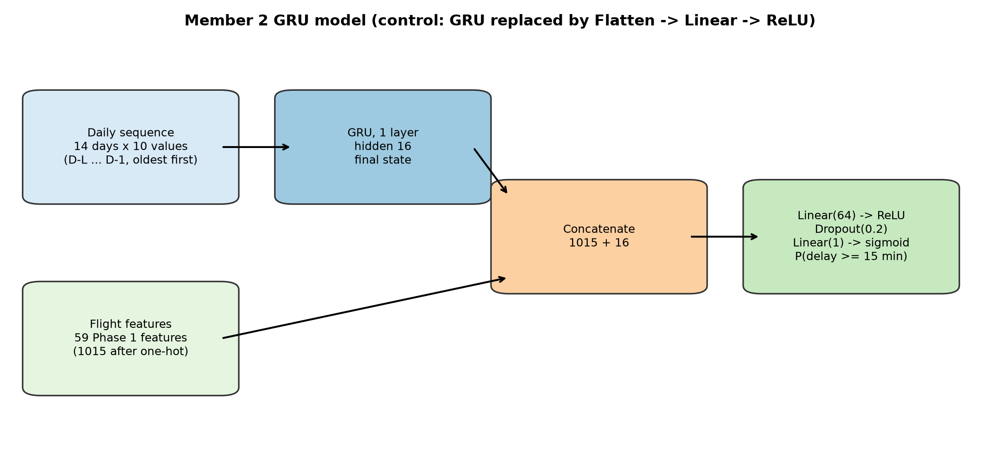
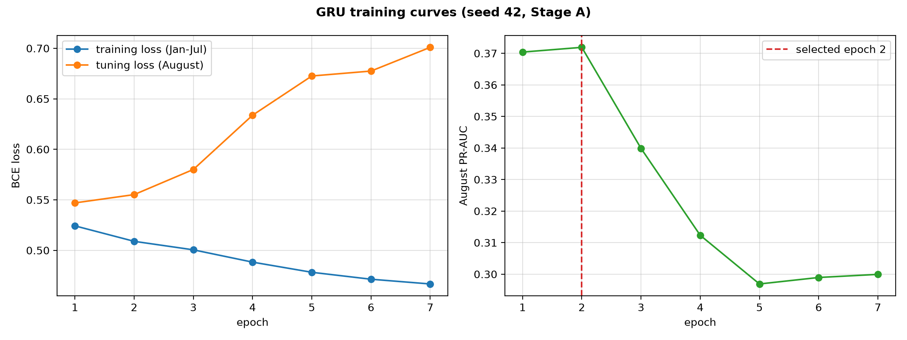
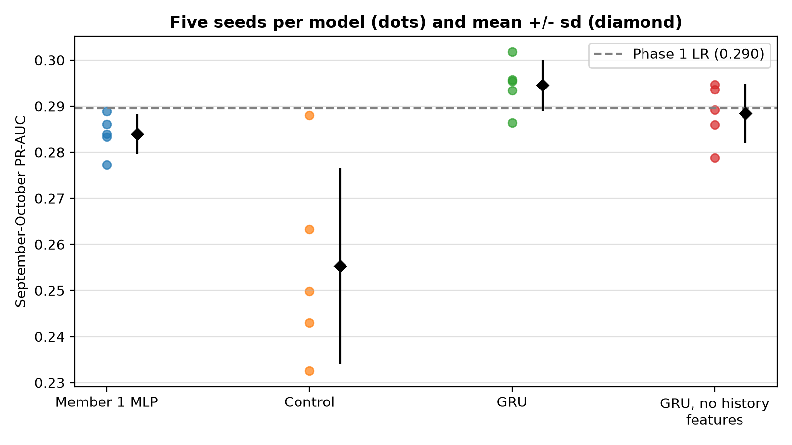

# Phase 2 — Member 2: GRU over ordered daily delay sequences

## Summary

Member 2 builds ordered daily sequences of past delays for each flight's airport and airline,
and trains a compact GRU that reads them together with the 59 Phase 1 features. The design was
written down before any training (D-303) and the results are recorded in D-304.

On September–October (55,628 flights, never used for any choice), averaged over five seeds:

| Model | PR-AUC | ROC-AUC | Brier | ECE |
|---|---|---|---|---|
| **GRU** (selected: 14 days, hidden size 16) | **0.295 ± 0.006** | 0.674 | 0.136 | 0.086 |
| Logistic Regression (Phase 1, D-202) | 0.290 | **0.680** | 0.186 | 0.233 |
| GRU without the 29 Phase 1 history features | 0.289 ± 0.006 | 0.675 | 0.135 | 0.084 |
| Member 1 MLP (no sequence) | 0.284 ± 0.004 | 0.672 | **0.133** | **0.076** |
| Control: same inputs, no recurrence | 0.255 ± 0.021 | 0.643 | 0.146 | 0.082 |

Delay rate 0.157. ± is the standard deviation over seeds 42–46.

What the 95% day-level bootstrap intervals say (pre-registered rule: a difference counts only if
its interval excludes 0):

* **GRU vs control: +0.039 [+0.009, +0.072], a real difference.** With the same inputs,
  reading the days in order with a GRU works better than feeding them in all at once.
* **GRU vs Logistic Regression: +0.005 [−0.014, +0.024], not a real difference.** The GRU does
  not beat the Phase 1 model.
* **GRU vs Member 1 MLP: +0.011 [−0.000, +0.022], not a real difference** (just short).
* **GRU without history features vs full GRU: −0.006 [−0.022, +0.008], no real difference.** The
  sequence alone recovers almost all of what the 29 hand-made history features provide.

---

## 1. Sequences

Code: `src/flight_delay/features/sequences.py`.

For a flight on day D the sequence covers the last L days, D−L … D−1, oldest first.

**When a past flight counts.** A past flight counts on the New York date on which its outcome
became known: actual arrival in New York time + 30 minutes (`outcome_known_date`, the Phase 1
rule, D-104/D-105). In the development data 10.6% of flights become known the day after they
fly (late landings), so grouping by flight date instead would leak part of day D−1's late
results into day D.

**Ten values per day:**

| Values | Why |
|---|---|
| Delay rate for the whole system, the origin, the carrier and the destination | The four levels at which delays spread (weather at New York, airline operations, destination problems). Rates are smoothed towards the global past rate, (k + 20·p)/(n + 20), as in Phase 1, so a destination with 2 flights does not show 0% or 100%. |
| log(1 + flights) for system, origin and carrier | How much evidence stands behind each rate, and how busy the day was. |
| Carrier has-data flag | So a day with no flights is not mistaken for an on-time day. |
| Weekday (sine, cosine) | Lets the GRU separate the normal Saturday dip from a genuinely calm day. |

Routes are left out: 220 routes, most with a few flights a day, so daily route rates are noise.
Only past delayed / not-delayed labels are used. Delay minutes and cancellations were checked on
January–August before the design was fixed: they add at most 0.006 R² for predicting the next
day's delay rate, so they were not worth the extra leakage risk.

**Storage.** Values are stored once per (day, entity) and each flight keeps only four indices;
sequences are gathered per batch. The arrays for all of January–October take under 1 MB.

**Padding and scaling.** Days before 1 January are padding: rates missing, counts and flags 0.
Each channel is standardised with the mean and standard deviation of that stage's training
flights only, and missing values become 0 (the training mean).

**Tests** (`tests/test_sequences.py`, 10 tests, no torch needed):
- changing every outcome from day D onwards leaves all sequences up to D unchanged;
- a D−1 flight landing after midnight is not in D's sequence;
- summing a carrier's, origin's or destination's last 1 or 7 steps gives exactly Phase 1's
  `hist_*_1d_n` / `hist_*_7d_n` for every flight, on synthetic data and on the real January–October
  data;
- the last step is D−1, the first day is all padding, unseen levels fall back to the global
  rate, and the scaler uses only the rows it is given.

---

## 2. Models

Code: `src/flight_delay/models/gru.py`. Diagram: `reports/figures/phase2_member2/gru_architecture.png`.



* **GRU:** the 14 × 10 sequence → 1-layer GRU (hidden size 16) → final state.
* **Control (no recurrence):** the same 14 × 10 values flattened → Linear(16) → ReLU.
* **Shared part:** the encoding is joined with the flight's 59 Phase 1 features, prepared exactly as
  in Member 1 (`MLPPreprocessor`: 49 scaled numeric + 966 one-hot = 1,015), then
  Linear(64) → ReLU → Dropout(0.2) → Linear(1).

The GRU and the control differ only in how the sequence is read, so comparing them isolates the
effect of recurrence. Comparing the GRU with Member 1's MLP isolates the effect of adding
sequences at all.

The GRU itself has about 1,300 weights. It is kept small because the signal is mostly yesterday
(day-to-day autocorrelation 0.36 at lag 1, 0.04 at lag 2) and Member 1's MLP already overfits
after one epoch.

---

## 3. Protocol and training

Code: `src/flight_delay/models/gru_training.py`, `scripts/train_gru.py`. Decision: D-303 (the
D-301 protocol).

| Period | Job |
|---|---|
| January–July (188,971 flights) | Fit (Stage A) |
| August (28,756) | Grid selection and early stopping (patience 5) on PR-AUC |
| January–August (217,727) | Refit for the chosen number of epochs, no early stopping (Stage B) |
| September–October (55,628) | Scored once, with the Phase 1 Logistic Regression on the same flights |
| November–December | Sealed, not read |

Adam (learning rate 0.001), batch 256, unweighted BCE, CPU, torch 2.15.0. The whole run (6 grid
runs and 20 final runs) takes about 9 minutes on a laptop CPU.

**Grid (seed 42, August PR-AUC):**

| L (days) | hidden 16 | hidden 32 |
|---|---|---|
| 7 | 0.3708 | 0.3692 |
| 14 | **0.3719** (selected) | 0.3685 |
| 28 | 0.3715 | 0.3678 |

All six lie within 0.004 of each other: sequence length barely matters, as expected when most
of the signal is the previous day. For reference, the Phase 1 models scored 0.401 (Logistic
Regression) and 0.396 (XGBoost) on August.



**Overfitting.** As with Member 1's MLP, August loss rises from the first epochs while training
loss keeps falling. The chosen epoch was 1 or 2 for every GRU seed.

---

## 4. Results on September–October



**Per month (mean PR-AUC over seeds):**

| Model | September (delay rate 0.137) | October (0.176) |
|---|---|---|
| GRU | 0.239 | 0.333 |
| Logistic Regression | **0.246** | 0.325 |
| GRU without history features | 0.245 | 0.320 |
| Member 1 MLP | 0.218 | **0.333** |
| Control | 0.198 | 0.298 |

The GRU is behind the Logistic Regression in September and ahead in October, which matches its
overall difference being within noise.

**Bootstrap intervals** (`reports/results/phase2_member2/bootstrap_pr_auc_differences.csv`;
1,000 resamples of whole days, each model's PR-AUC averaged over its five seeds):

| Difference in PR-AUC | Estimate | 95% interval | Real? |
|---|---|---|---|
| GRU − Logistic Regression | +0.005 | [−0.014, +0.024] | No |
| GRU − control | +0.039 | [+0.009, +0.072] | **Yes** |
| GRU − Member 1 MLP | +0.011 | [−0.000, +0.022] | No |
| Control − Logistic Regression | −0.034 | [−0.070, +0.006] | No |
| Member 1 MLP − Logistic Regression | −0.006 | [−0.024, +0.012] | No |
| GRU without history − GRU | −0.006 | [−0.022, +0.008] | No |

Whole days are resampled because flights on the same day share the same weather; treating
55,628 flights as independent would make the intervals too narrow.

**Calibration.** The GRU's raw probabilities are too high on average (0.243 against a 0.157
delay rate; ECE 0.086), like Member 1's MLP and for the same reason: September–October is calmer
than the training months. Calibration is Member 5's task.

---

## 5. Reading

1. **Recurrence helps compared with the same inputs flattened.** The GRU beats the control by
   0.039 and the interval excludes zero. The control is also unstable: its five seeds range from
   0.233 to 0.288, and one seed reached a very high August score (0.444) that did not carry over
   to September–October. Reading the days in order is the more reliable way to use them. This
   shows the GRU uses the sequence better than a flat layer of the same size; it does not by
   itself prove that long temporal patterns exist, and the grid suggests they are weak.
2. **No model beats the Phase 1 Logistic Regression.** The GRU is the best Phase 2 model so far
   (+0.005 over Logistic Regression, +0.011 over the MLP), but neither difference is outside
   noise. The 59 Phase 1 features already contain the previous-day signal that the sequences
   carry.
3. **The GRU can learn the history features by itself.** Without the 29 hand-made history
   features, the GRU loses only 0.006 (not significant). That is useful for Member 4's ablations.
4. **The limit is the information, not the model.** Yesterday's delays explain only about 12% of
   the variation in today's delay rate. The rest is mostly that day's weather, which is not
   known at the end of D−1. Further gains need new information (e.g. weather forecasts), not a
   bigger sequence model.

---

## 6. Files

```bash
python scripts/train_gru.py            # needs torch; about 9 minutes on CPU; refuses to overwrite
python scripts/train_gru.py --smoke --out /tmp/gru_smoke   # 10-second pipeline check
pytest tests/test_sequences.py tests/test_gru.py
```

| Path | Contents |
|---|---|
| `models/phase2/member2/gru_final.pth` | Selected GRU, seed 42, refit January–August |
| `models/phase2/member2/static_preprocessor.joblib` | Fitted `MLPPreprocessor` (January–August) |
| `models/phase2/member2/sequence_scaler.npz` | Channel means and standard deviations (January–August flights) |
| `models/phase2/member2/model_config.json` | Selected L and hidden size, settings, seeds, torch version |
| `models/phase2/member2/training_histories.json` | Every grid and final run, epoch by epoch |
| `reports/results/phase2_member2/grid_august.csv` | Grid scores |
| `reports/results/phase2_member2/august_selection_runs.csv` | Chosen epoch and August scores per model and seed |
| `reports/results/phase2_member2/per_seed_metrics.csv` | September–October metrics per model, seed and month |
| `reports/results/phase2_member2/comparison.csv` | Means and standard deviations over seeds |
| `reports/results/phase2_member2/bootstrap_pr_auc_differences.csv` | Day-level bootstrap intervals |
| `reports/results/phase2_member2/sep_oct_predictions.parquet` | Every model's September–October probabilities, by flight id (for Member 5) |
| `reports/figures/phase2_member2/` | Architecture, training curves, grid, seed comparison, precision–recall curves |
| `notebooks/phase2_member2_gru.ipynb` | Read-only results summary |
