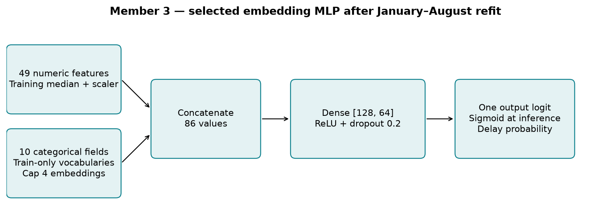
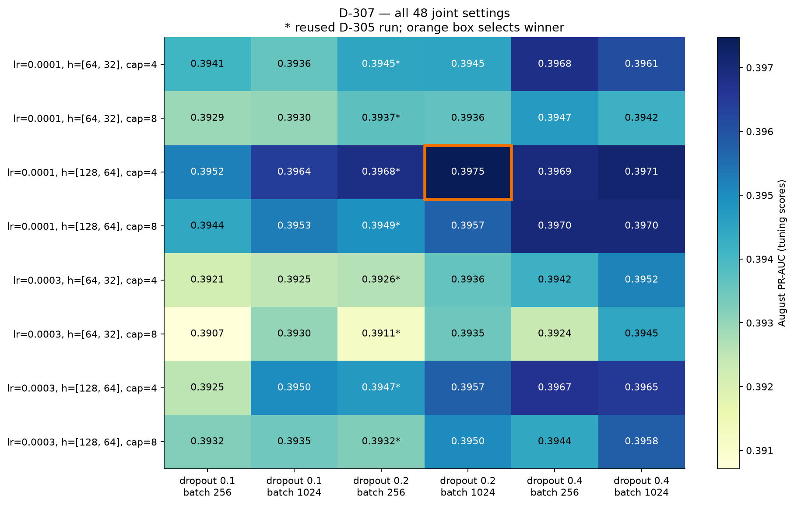
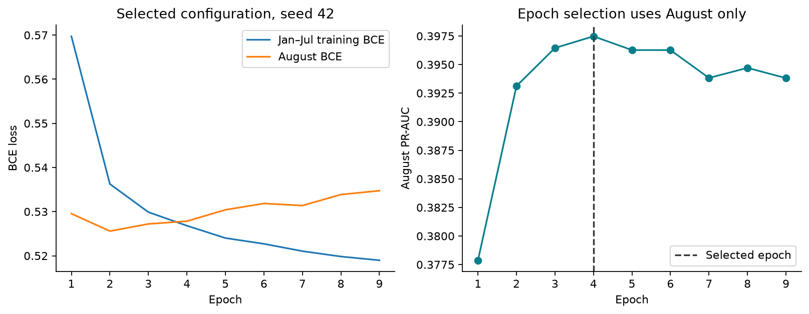
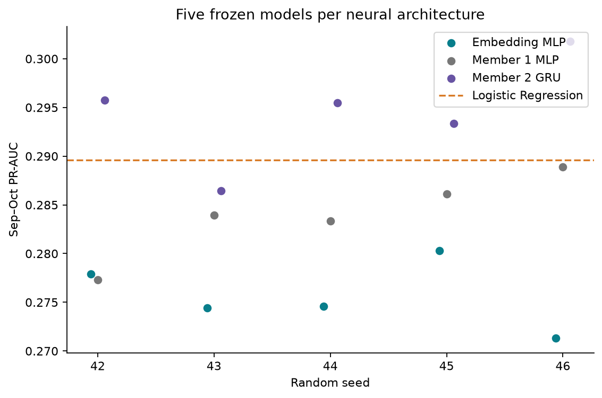
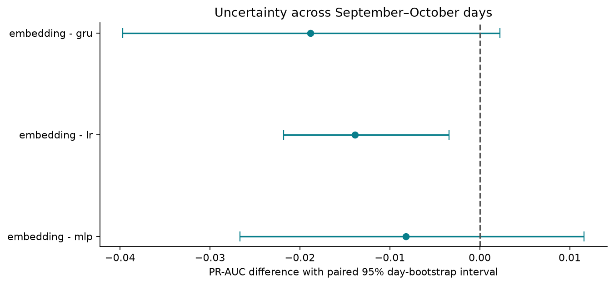

# Phase 2 — Member 3 embedding MLP — D-307 final

## Amendment and evaluation disclosure

> Sep–Oct was scored once under D-305 (D-306) before this amendment. D-307 replaces D-306 as the Member 3 result because D-305 did not tune batch size and dropout as assigned. Sep–Oct is not used for any choice.

D-307 is the final Member 3 experiment. Historical D-305/D-306 records, checkpoints,
predictions and figures retain their original bytes. The report below shows both versions.

## Scope and ownership

Aditya Ranjan implemented the categorical-embedding model, its preprocessing, August-only
hyperparameter selection, five-seed refits and paired comparisons. Member 1's seeding utilities,
Member 2's logit metrics and sigmoid, and `scripts/train_gru.py::day_bootstrap` are imported.
Their implementation and saved artifacts retain their original contents.

## Relevant methodological literature

The following primary-source abstracts were verified for this implementation.

- Guo and Berkhahn (2016) learn supervised entity embeddings for categorical fields.
  This motivates replacing sparse one-hot inputs with trainable category representations.
  [Entity Embeddings of Categorical Variables](https://arxiv.org/abs/1604.06737)
- Srivastava et al. (2014) introduce dropout to reduce co-adaptation and overfitting.
  This motivates including dropout in the D-307 tuning grid.
  [Dropout, JMLR](https://jmlr.org/papers/v15/srivastava14a.html)
- Gorishniy et al. (2021) compare tabular neural architectures and boosted trees under
  consistent protocols. This motivates retaining strong ML baselines and measuring the
  embedding MLP's value with the same flights and metrics.
  [Revisiting Deep Learning Models for Tabular Data](https://arxiv.org/abs/2106.11959)

## Question and architecture

Can learned categorical representations improve next-day arrival-delay classification compared
with one-hot MLP, Logistic Regression and GRU on identical flights?

The target is arrival delay of at least 15 minutes, conditional on an observed arrival label.
The decision cutoff is the end of D−1. Inputs are the frozen 49 numeric and 10 categorical
features from Phase 1. Each categorical field has a learned embedding with dimension
`max(1, min(cap, ceil(sqrt(training vocabulary size))))`.

Selected architecture settings are learning rate 0.0001, hidden layers [128, 64], embedding cap 4, dropout 0.2, batch size 1024. The January–August refit has
23,315 trainable parameters, with embedding dimensions [4, 2, 4, 4, 3, 4, 4, 4, 4, 4].
Embeddings and scaled numeric values are concatenated, followed by two dense layers, ReLU,
dropout 0.2 after each hidden layer, and one logit. Sigmoid converts logits
to probabilities at inference. Airline and route representations learn jointly with the loss.



## Registered experiment and preprocessing

D-307 was committed as `90eecd5` before amended training. The full Cartesian grid has
48 configurations, with learning rates 0.0001/0.0003, widths (64,32)/(128,64), embedding caps
4/8, dropout 0.1/0.2/0.4, and batch size 256/1024. Eight D-305 runs at dropout 0.2 and batch
256 were reused after verifying their original source, input and selection records. Forty
new configurations were trained. Original record paths and hashes are saved with reused runs.
Fixed choices are Adam, weight decay 0.0001, unweighted binary cross-entropy with logits,
CPU, maximum 30 epochs and patience 5.

Binary cross-entropy is `-[y log(p) + (1-y) log(1-p)]`. Learning embeddings and network weights
minimises this objective. Dropout and weight decay constrain overfitting. The lower learning
rates follow the earlier models' early August peaks. Small layers and low-dimensional
embeddings limit capacity on a modest tabular dataset.

The January–July vocabulary uses training counts to collapse rare levels to `__OTHER__`.
Numeric medians and StandardScaler statistics use those training rows only. August and later
unseen levels map to the reserved category. For final training, preprocessing is fitted anew
on January–August and model weights are reinitialised. This can change vocabulary sizes.

| Period | Use | Labelled flights |
| --- | --- | --- |
| January–July | Fit all grid candidates | 188,971 |
| August | Select configuration and epochs by PR-AUC | 28,756 |
| January–August | Fixed-epoch final refit | 217,727 |
| September–October | Final comparison | 55,628 |
| November–December | Sealed during Member 3 work | Excluded |

Each configuration uses seed 42. Exact PR-AUC ties prefer fewer parameters, then lower
learning rate, then configuration order. Earliest epochs win equal-score checkpoint ties.
After the architecture is frozen, each seed 42–46 selects its own epoch on August and refits
January–August for exactly that count. September–October has no role in these decisions.

## August selection

| run | learning_rate | hidden_dims | embedding_cap | dropout | batch_size | parameters | best_epoch | august_pr_auc |
| --- | --- | --- | --- | --- | --- | --- | --- | --- |
| d307_001 | 0.0001 | [64, 32] | 4 | 0.1 | 256 | 11523 | 2 | 0.39409 |
| d307_002 | 0.0001 | [64, 32] | 4 | 0.1 | 1024 | 11523 | 6 | 0.39358 |
| d307_003 | 0.0001 | [64, 32] | 4 | 0.2 | 256 | 11523 | 2 | 0.39448 |
| d307_004 | 0.0001 | [64, 32] | 4 | 0.2 | 1024 | 11523 | 6 | 0.39451 |
| d307_005 | 0.0001 | [64, 32] | 4 | 0.4 | 256 | 11523 | 4 | 0.3968 |
| d307_006 | 0.0001 | [64, 32] | 4 | 0.4 | 1024 | 11523 | 11 | 0.39609 |
| d307_007 | 0.0001 | [64, 32] | 8 | 0.1 | 256 | 16555 | 4 | 0.39291 |
| d307_008 | 0.0001 | [64, 32] | 8 | 0.1 | 1024 | 16555 | 8 | 0.39298 |
| d307_009 | 0.0001 | [64, 32] | 8 | 0.2 | 256 | 16555 | 3 | 0.39372 |
| d307_010 | 0.0001 | [64, 32] | 8 | 0.2 | 1024 | 16555 | 8 | 0.39363 |
| d307_011 | 0.0001 | [64, 32] | 8 | 0.4 | 256 | 16555 | 6 | 0.39472 |
| d307_012 | 0.0001 | [64, 32] | 8 | 0.4 | 1024 | 16555 | 12 | 0.3942 |
| d307_013 | 0.0001 | [128, 64] | 4 | 0.1 | 256 | 23299 | 2 | 0.39521 |
| d307_014 | 0.0001 | [128, 64] | 4 | 0.1 | 1024 | 23299 | 4 | 0.39644 |
| d307_015 | 0.0001 | [128, 64] | 4 | 0.2 | 256 | 23299 | 2 | 0.39683 |
| d307_016 | 0.0001 | [128, 64] | 4 | 0.2 | 1024 | 23299 | 4 | 0.39747 |
| d307_017 | 0.0001 | [128, 64] | 4 | 0.4 | 256 | 23299 | 3 | 0.39694 |
| d307_018 | 0.0001 | [128, 64] | 4 | 0.4 | 1024 | 23299 | 6 | 0.39713 |
| d307_019 | 0.0001 | [128, 64] | 8 | 0.1 | 256 | 29739 | 2 | 0.39441 |
| d307_020 | 0.0001 | [128, 64] | 8 | 0.1 | 1024 | 29739 | 4 | 0.39528 |
| d307_021 | 0.0001 | [128, 64] | 8 | 0.2 | 256 | 29739 | 3 | 0.39493 |
| d307_022 | 0.0001 | [128, 64] | 8 | 0.2 | 1024 | 29739 | 4 | 0.39572 |
| d307_023 | 0.0001 | [128, 64] | 8 | 0.4 | 256 | 29739 | 3 | 0.39698 |
| d307_024 | 0.0001 | [128, 64] | 8 | 0.4 | 1024 | 29739 | 8 | 0.397 |
| d307_025 | 0.0003 | [64, 32] | 4 | 0.1 | 256 | 11523 | 1 | 0.39213 |
| d307_026 | 0.0003 | [64, 32] | 4 | 0.1 | 1024 | 11523 | 2 | 0.39249 |
| d307_027 | 0.0003 | [64, 32] | 4 | 0.2 | 256 | 11523 | 1 | 0.39262 |
| d307_028 | 0.0003 | [64, 32] | 4 | 0.2 | 1024 | 11523 | 2 | 0.39359 |
| d307_029 | 0.0003 | [64, 32] | 4 | 0.4 | 256 | 11523 | 1 | 0.39419 |
| d307_030 | 0.0003 | [64, 32] | 4 | 0.4 | 1024 | 11523 | 3 | 0.39515 |
| d307_031 | 0.0003 | [64, 32] | 8 | 0.1 | 256 | 16555 | 1 | 0.39071 |
| d307_032 | 0.0003 | [64, 32] | 8 | 0.1 | 1024 | 16555 | 3 | 0.39299 |
| d307_033 | 0.0003 | [64, 32] | 8 | 0.2 | 256 | 16555 | 2 | 0.39114 |
| d307_034 | 0.0003 | [64, 32] | 8 | 0.2 | 1024 | 16555 | 3 | 0.39348 |
| d307_035 | 0.0003 | [64, 32] | 8 | 0.4 | 256 | 16555 | 2 | 0.39237 |
| d307_036 | 0.0003 | [64, 32] | 8 | 0.4 | 1024 | 16555 | 4 | 0.39446 |
| d307_037 | 0.0003 | [128, 64] | 4 | 0.1 | 256 | 23299 | 1 | 0.39252 |
| d307_038 | 0.0003 | [128, 64] | 4 | 0.1 | 1024 | 23299 | 1 | 0.395 |
| d307_039 | 0.0003 | [128, 64] | 4 | 0.2 | 256 | 23299 | 1 | 0.39473 |
| d307_040 | 0.0003 | [128, 64] | 4 | 0.2 | 1024 | 23299 | 2 | 0.39573 |
| d307_041 | 0.0003 | [128, 64] | 4 | 0.4 | 256 | 23299 | 1 | 0.39666 |
| d307_042 | 0.0003 | [128, 64] | 4 | 0.4 | 1024 | 23299 | 2 | 0.39655 |
| d307_043 | 0.0003 | [128, 64] | 8 | 0.1 | 256 | 29739 | 1 | 0.39322 |
| d307_044 | 0.0003 | [128, 64] | 8 | 0.1 | 1024 | 29739 | 2 | 0.39346 |
| d307_045 | 0.0003 | [128, 64] | 8 | 0.2 | 256 | 29739 | 1 | 0.39323 |
| d307_046 | 0.0003 | [128, 64] | 8 | 0.2 | 1024 | 29739 | 2 | 0.39503 |
| d307_047 | 0.0003 | [128, 64] | 8 | 0.4 | 256 | 29739 | 2 | 0.39441 |
| d307_048 | 0.0003 | [128, 64] | 8 | 0.4 | 1024 | 29739 | 2 | 0.39579 |

Winner `d307_016` has August PR-AUC 0.39747 at epoch
4 for seed 42. These are tuning scores.

| seed | best_epoch | august_pr_auc |
| --- | --- | --- |
| 42 | 4 | 0.39747 |
| 43 | 5 | 0.39681 |
| 44 | 5 | 0.39699 |
| 45 | 10 | 0.39671 |
| 46 | 4 | 0.39769 |




## D-306 and D-307 side by side

| result | dropout | batch_size | August tuning PR-AUC | pr_auc | roc_auc | brier_score | ece_10 | pr_auc_std |
| --- | --- | --- | --- | --- | --- | --- | --- | --- |
| D-306 historical | 0.2 | 256 | 0.39683 | 0.2762 | 0.67528 | 0.12793 | 0.04732 | 0.00242 |
| D-307 final | 0.2 | 1024 | 0.39747 | 0.27572 | 0.67483 | 0.12826 | 0.05034 | 0.00347 |

D-306 remains a historical result. D-307 supersedes it because the amended joint grid covers
the assigned batch-size and dropout tuning. September–October metrics are reported after
the August-only choice is frozen. They do not select a configuration or a result version.

## Final September–October results

All four model families use the exact same 55,628 flight IDs, dates and labels.
The delay rate is 0.1570. Neural model metrics are means and sample standard
deviations over seeds 42–46. Logistic Regression is the saved Phase 1 model and has one run.
All probabilities are raw. Monthly results are in `comparison.csv`.

| model | pr_auc_mean | pr_auc_std | roc_auc_mean | brier_score_mean | ece_10_mean |
| --- | --- | --- | --- | --- | --- |
| embedding | 0.27572 | 0.00347 | 0.67483 | 0.12826 | 0.05034 |
| gru | 0.29457 | 0.00552 | 0.67434 | 0.136 | 0.08628 |
| lr | 0.28959 | — | 0.68 | 0.18554 | 0.23341 |
| mlp | 0.28393 | 0.00429 | 0.67187 | 0.13327 | 0.07574 |




## Paired uncertainty analysis

The existing Member 2 bootstrap resamples all 61 evaluation days with replacement 1,000 times.
It computes each model's PR-AUC per seed, averages over seeds, then takes the paired difference
on the same sampled flights. It does not average probabilities into a new ensemble. An
improvement requires the entire 95% interval to be positive, as registered in D-307.

| comparison | difference | ci_low | ci_high | excludes_zero |
| --- | --- | --- | --- | --- |
| embedding - mlp | -0.00821 | -0.02668 | 0.01158 | False |
| embedding - lr | -0.01387 | -0.02181 | -0.0034 | True |
| embedding - gru | -0.01885 | -0.03969 | 0.00226 | False |

No comparison has a positive 95% interval entirely above zero. Negative intervals support lower PR-AUC for embedding - lr.



## Interpretation and limits

Learned embeddings provide a compact way to model airline, route and time-bucket interactions.
The measured differences and their uncertainty determine the performance conclusion. The
grid and epochs remain fixed after observing evaluation results.

The model comparison changes representation, width and optimisation together. Matched
ablation experiments by Member 4 can isolate the contribution of embeddings. The LR baseline
uses balanced class weights, while the neural models use unweighted BCE. This also influences
the raw probability calibration comparison.

These results cover one year's NYC departures, schedule information and past-known outcomes.
Weather forecasts and same-day operational signals are absent. Early stopping addresses
overfitting but cannot supply missing information. Raw probability reliability is reported;
probability calibration belongs to Member 5's separately designed evaluation work.

The earlier project history includes prior exposure to evaluation periods, disclosed in D-000
and D-301. September–October is a shared evaluation period already viewed by earlier members.
The bootstrap reflects variation across these days, conditional on the fixed model designs and
five selected seeds. It does not establish performance in unseen years or correct historical
evaluation exposure. Additional architectures would need a new registered experiment.

## Reproduction and recovery

Use Python 3.11 and the recorded environment in `environment.txt`. Saved results can be read
without retraining. On a clean development checkout, install requirements and the package,
create the dedicated January–October development file with the existing preparation script,
then execute these stages in order.

```bash
python scripts/train_embedding_mlp.py --stage check
python scripts/train_embedding_mlp.py --stage tune
python scripts/train_embedding_mlp.py --stage refit
python scripts/train_embedding_mlp.py --stage evaluate
python scripts/report_embedding_mlp.py
```

Completed selection, refits and evaluation are protected from overwrite. Interrupted tuning
and refits reuse completed records after checking source and input hashes. If bootstrapping is
interrupted, evaluation resumes from saved probabilities and avoids rescoring frozen models.
Source hashes and the D-307 hash are stored in every stage. Each final checkpoint and the
fitted preprocessor have hashes in `models/phase2/member3/refit_d307/frozen.json`.

## Deliverables

- `src/flight_delay/models/embedding_mlp.py` and `embedding_training.py`
- `scripts/train_embedding_mlp.py` and `report_embedding_mlp.py`
- `tests/test_embedding_mlp.py` and `test_embedding_pipeline.py`
- `models/phase2/member3/refit_d307/` with five seed checkpoints and preprocessing
- `reports/results/phase2_member3/d307/` with all registered runs and final comparisons
- `reports/figures/phase2_member3/d307/` with architecture and diagnostic figures
- `notebooks/phase2_member3_embedding_mlp.ipynb` with read-only results
