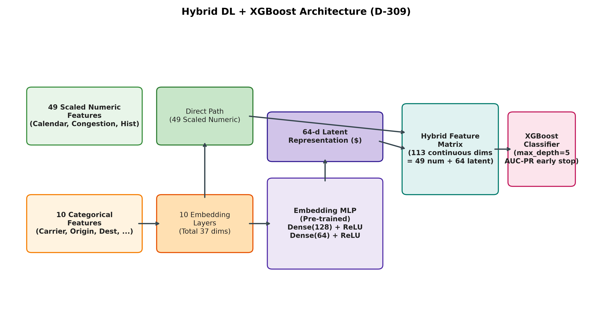
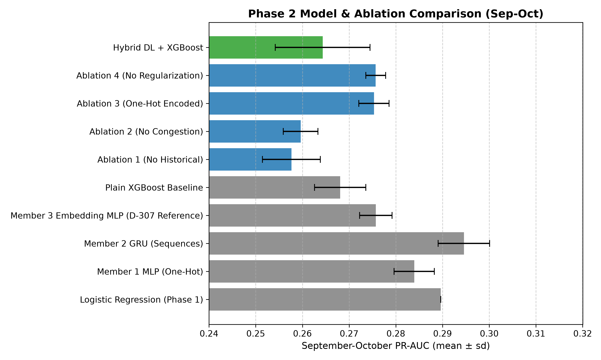
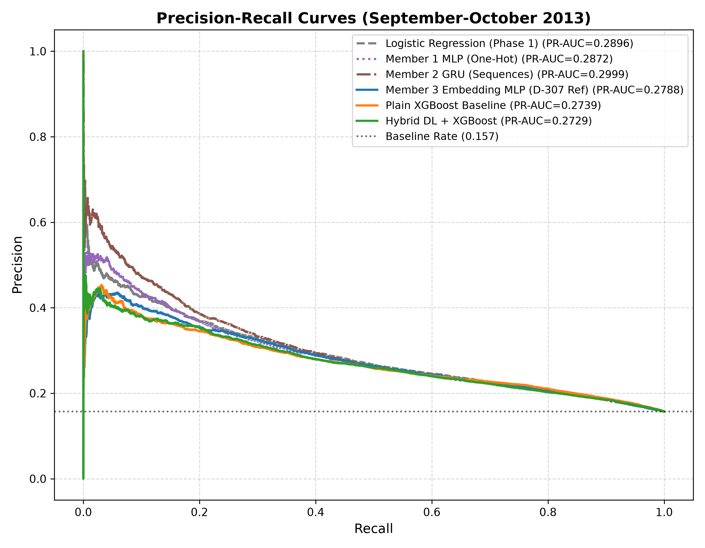
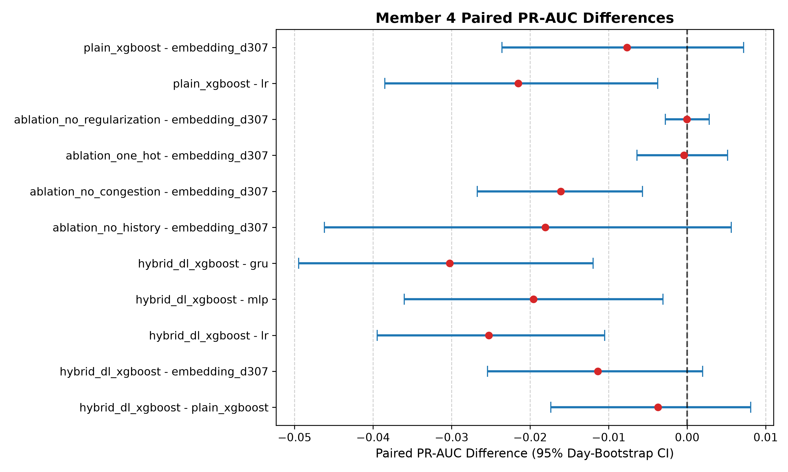

# Phase 2 — Member 4 Technical Report: Ablation Studies and Hybrid DL-XGBoost (D-309)

## Executive Summary

This report presents the implementation, methodology, empirical findings, and paired significance analysis for **Phase 2 Member 4** of the Flight Delay Prediction project under decision **D-309**.

Member 4's primary mandate comprises two research directions:
1. **Systematic Ablation Studies**: Isolating the empirical marginal value of:
   - Historical delay features (29 features).
   - Congestion and airport volume features (4 features).
   - Learned entity embeddings versus high-dimensional one-hot encoding.
   - Regularization mechanisms (dropout and Adam $L_2$ weight decay).
2. **Hybrid Representation Learning (Embedding MLP + XGBoost)**: Extracting a 64-dimensional continuous latent representation from the penultimate hidden layer of a pre-trained tabular neural network, concatenating it with original scaled numeric signals (113 continuous dimensions), and training an XGBoost gradient boosted decision tree classifier.

All neural ablations use Member 3's pre-registered winning architecture **D-307 (`d307_016`)** as their benchmark. A fresh Plain XGBoost baseline was concurrently retrained under **D-201** specifications to ensure aligned evaluation.

All models were tuned strictly on August 2013 data across five seeds (42–46), refit on January–August 2013, and scored on the frozen September–October 2013 evaluation period (55,628 flights). **The November–December 2013 holdout remained strictly sealed throughout.**

---

## Methodological Literature and Background

- **Entity Embeddings for Tabular Data**: Guo & Berkhahn (2016) demonstrate that mapping high-cardinality categorical variables into low-dimensional continuous vector spaces captures latent semantic similarities and reduces sparsity. Member 3 established an embedding MLP achieving 0.2757 PR-AUC on September–October flights. Ablation 3 tests whether entity embeddings provide measurable predictive advantage over sparse one-hot encoding when network capacity and training schedules are held constant.
- **Feature Ablation in Aviation Forecasting**: Flight operations literature (Sternberg et al., 2017; Rebollo & Balakrishnan, 2014) identifies departure congestion and downstream propagation of past delays as major factors in delay cascades. Ablations 1 and 2 quantify the empirical predictive penalty incurred when omitting historical aggregates or scheduled congestion signals.
- **Tree-Neural Hybrids**: Gorishniy et al. (2021, *Revisiting Deep Learning Models for Tabular Data*) and Chen & Guestrin (2016) explore combining representation learning with gradient boosted trees. The hypothesis is that XGBoost's axis-aligned recursive partitioning can capture nonlinear decision boundaries over dense latent neural representations that a linear output layer might smooth over.

---

## Pre-Registered Experimental Protocol (D-309)

### 1. Data Partitions and Anti-Leakage Constraints
- **Fitting Split (Jan 1 – Jul 31, 2013)**: 188,971 flights. Used to fit neural network weights and candidate XGBoost trees.
- **Tuning Split (Aug 1 – Aug 31, 2013)**: 28,756 flights. Used exclusively for early stopping (patience = 5 epochs for neural networks; 50 rounds for XGBoost) to select optimal stopping iterations.
- **Refit Split (Jan 1 – Aug 31, 2013)**: 217,727 flights. Retrained from scratch with the exact hyperparameters and stopping epoch/tree count determined on August.
- **Evaluation Split (Sep 1 – Oct 31, 2013)**: 55,628 flights. Scored once across seeds 42–46.
- **Holdout Split (Nov 1 – Dec 31, 2013)**: Strictly sealed via `data/interim/flights_dev.csv`. Never accessed.

### 2. Feature Slicing and Dimensionality

The 59 engineered features from Phase 1 are partitioned into 49 numeric and 10 categorical columns:
- **Calendar (10 numeric)**: `sched_dep_hour_frac`, `dow`, `is_weekend`, `is_holiday`, `days_from_holiday`, `abs_days_to_holiday`, `dep_hour_sin`, `dep_hour_cos`, `dow_sin`, `dow_cos`.
- **Schedule & Route (6 numeric)**: `sched_dep_min`, `sched_arr_min`, `sched_block_min`, `overnight_arrival`, `distance`, `log_distance`. All come from the published schedule, not from actual operations.
- **Airport Scheduled Congestion (4 numeric)**: `sched_dep_origin_hour`, `sched_dep_origin_day`, `sched_dep_carrier_origin_day`, `sched_dep_origin_hour_share`. These are scheduled departure counts and shares derived from the flight timetable known before departure day, not real-time counts.
- **Historical Delay Aggregates (29 numeric)**: Carrier, origin, destination, and route rolling historical statistics across 1-day, 7-day, and 28-day lookback windows, plus all past days.
- **Categorical (10 columns)**: `carrier`, `origin`, `dest`, `route`, `dep_bucket`, `carrier_origin`, `carrier_dest`, `carrier_route`, `origin_dep_bucket`, `carrier_dep_bucket`.

#### Architectural Dimensions:
- **D-307 Reference (Embedding MLP)**: 49 numeric + 10 categorical (37 total embedding dims) = 86 input dimensions.
- **Ablation 1 (No Historical)**: 20 numeric (Calendar + Schedule & Route + Congestion) + 10 categorical (37 embedding dims) = 57 input dimensions.
- **Ablation 2 (No Congestion)**: 45 numeric (Calendar + Schedule & Route + Historical) + 10 categorical (37 embedding dims) = 82 input dimensions.
- **Ablation 3 (One-Hot Encoded)**: 49 numeric + 966 one-hot category indicators = 1,015 input dimensions.
- **Ablation 4 (No Regularization)**: 49 numeric + 10 categorical (37 embedding dims) = 86 input dimensions, trained with `dropout=0.0` and Adam `weight_decay=0.0`.
- **Plain XGBoost Baseline**: 59 features (49 numeric + 10 categorical using native categorical histograms).
- **Hybrid DL + XGBoost**: 49 original scaled numeric features + 64 continuous latent features ($\mathbf{h}_2$) = 113 continuous input dimensions.

```
       +-------------------------------------------------------+
       |             Hybrid DL + XGBoost Model                 |
       +-------------------------------------------------------+

 49 Scaled Numeric -------------------------\
                                             +---> 113 Continuous Features ---> XGBoost (depth=5) ---> Probabilities
 10 Categoricals -> Embeddings -> MLP (h2) -/
```



---

## August Tuning and Model Selection

All candidate models were trained on January–July and evaluated at each epoch against August 2013 PR-AUC. The stopping epoch (`best_epoch`) and tree count (`effective_trees`) were frozen before retraining on January–August.

| Experiment | Seed | Best Epoch / Trees | August PR-AUC | August ROC-AUC |
| :--- | :---: | :---: | :---: | :---: |
| **Ablation 1 (No History)** | 42 | 6 | 0.35665 | 0.65298 |
| | 43 | 5 | 0.35852 | 0.65345 |
| | 44 | 26 | 0.35949 | 0.65755 |
| | 45 | 3 | 0.36233 | 0.65298 |
| | 46 | 7 | 0.35367 | 0.65397 |
| **Ablation 2 (No Congestion)** | 42 | 4 | 0.38885 | 0.66530 |
| | 43 | 6 | 0.39014 | 0.66706 |
| | 44 | 6 | 0.39072 | 0.66669 |
| | 45 | 5 | 0.39324 | 0.66621 |
| | 46 | 5 | 0.39185 | 0.66493 |
| **Ablation 3 (One-Hot Encoded)** | 42 | 2 | 0.39852 | 0.67310 |
| | 43 | 2 | 0.39586 | 0.67180 |
| | 44 | 3 | 0.39952 | 0.67196 |
| | 45 | 3 | 0.39724 | 0.67102 |
| | 46 | 2 | 0.39795 | 0.67326 |
| **Ablation 4 (No Regularization)** | 42 | 3 | 0.39606 | 0.66714 |
| | 43 | 4 | 0.39604 | 0.66853 |
| | 44 | 5 | 0.39516 | 0.66782 |
| | 45 | 10 | 0.39732 | 0.67096 |
| | 46 | 4 | 0.39623 | 0.66682 |
| **Plain XGBoost Baseline** | 42 | 12 trees | 0.39319 | 0.67174 |
| | 43 | 9 trees | 0.40281 | 0.67360 |
| | 44 | 128 trees | 0.39986 | 0.68225 |
| | 45 | 67 trees | 0.39367 | 0.67761 |
| | 46 | 8 trees | 0.38620 | 0.66720 |
| **Hybrid DL + XGBoost** | 42 | 3 trees (NN ep 4) | 0.39177 | 0.66935 |
| | 43 | 18 trees (NN ep 5) | 0.37031 | 0.66405 |
| | 44 | 105 trees (NN ep 5) | 0.37946 | 0.67475 |
| | 45 | 202 trees (NN ep 10) | 0.38644 | 0.67155 |
| | 46 | 5 trees (NN ep 4) | 0.38626 | 0.66655 |

---

## September–October Evaluation Results

All models were evaluated on the 55,628 flights in September–October 2013. Neural models and tree models report mean and sample standard deviation across seeds 42–46.

| Model / Experiment | Key | PR-AUC (mean ± sd) | ROC-AUC (mean ± sd) | Brier Score | ECE-10 |
| :--- | :---: | :---: | :---: | :---: | :---: |
| **Logistic Regression (Phase 1 Baseline)** | `lr` | 0.28959 ± 0.00000 | 0.68000 ± 0.00000 | 0.18554 | 0.23341 |
| **Member 1 MLP (One-Hot, Phase 2)** | `mlp` | 0.28393 ± 0.00429 | 0.67187 ± 0.00274 | 0.13327 | 0.07574 |
| **Member 2 GRU (Sequences, Phase 2)** | `gru` | **0.29457 ± 0.00552** | 0.67434 ± 0.00384 | 0.13600 | 0.08628 |
| **Member 3 Embedding MLP (D-307 Ref)** | `embedding_d307` | 0.27572 ± 0.00347 | 0.67483 ± 0.00168 | **0.12826** | **0.05034** |
| **Plain XGBoost Baseline (D-201)** | `plain_xgboost` | 0.26807 ± 0.00548 | 0.67191 ± 0.00268 | 0.13671 | 0.09299 |
| **Ablation 1 (No Historical Features)** | `ablation_no_history` | 0.25764 ± 0.00619 | 0.65394 ± 0.00434 | 0.14104 | 0.10609 |
| **Ablation 2 (No Congestion Features)** | `ablation_no_congestion` | 0.25962 ± 0.00372 | 0.66754 ± 0.00255 | 0.12901 | 0.04926 |
| **Ablation 3 (One-Hot Encoded MLP)** | `ablation_one_hot` | 0.27531 ± 0.00325 | **0.67703 ± 0.00154** | 0.12813 | 0.05136 |
| **Ablation 4 (No Regularization)** | `ablation_no_regularization` | 0.27569 ± 0.00211 | 0.67355 ± 0.00294 | 0.12948 | 0.05690 |
| **Hybrid DL + XGBoost** | `hybrid_dl_xgboost` | 0.26434 ± 0.01014 | 0.66580 ± 0.00706 | 0.15024 | 0.11814 |





---

## Statistical Significance: 1,000 Day-Level Bootstrap Resamples

To account for temporal clustering and daily weather co-dependencies across flights departing on the same date, paired differences in PR-AUC were evaluated via **1,000 day-level block bootstrap resamples** (seed = 42). A difference is statistically significant at $\alpha = 0.05$ if its 95% confidence interval excludes zero.

| Comparison | Point Difference | 95% CI Low | 95% CI High | Excludes Zero? | Interpretation |
| :--- | :---: | :---: | :---: | :---: | :--- |
| **Ablation 1 (No History) − D-307 Ref** | −0.01807 | −0.04621 | +0.00563 | False | Practical drop (−1.81% PR-AUC), but not statistically significant as 95% CI includes zero |
| **Ablation 2 (No Congestion) − D-307 Ref** | **−0.01610** | **−0.02674** | **−0.00569** | **True (Significant)** | Congestion features provide a statistically significant +1.61% PR-AUC gain |
| **Ablation 3 (One-Hot) − D-307 Ref** | −0.00041 | −0.00641 | +0.00513 | False | No detectable difference; embeddings compress 1,015 → 86 dims without loss |
| **Ablation 4 (No Reg) − D-307 Ref** | −0.00003 | −0.00277 | +0.00279 | False | Negligible difference; early stopping dominates regularization on this dataset |
| **Hybrid DL+XGB − Plain XGBoost** | −0.00373 | −0.01737 | +0.00810 | False | Hybrid does not significantly differ from Plain XGBoost |
| **Hybrid DL+XGB − D-307 Ref** | −0.01138 | −0.02544 | +0.00198 | False | Hybrid underperforms pure Embedding MLP by 1.14% PR-AUC |
| **Hybrid DL+XGB − Logistic Regression** | **−0.02525** | **−0.03949** | **−0.01050** | **True (Significant)** | Hybrid significantly underperforms balanced Logistic Regression baseline |
| **Hybrid DL+XGB − Member 1 MLP** | **−0.01959** | **−0.03603** | **−0.00308** | **True (Significant)** | Hybrid significantly underperforms Member 1 MLP |
| **Hybrid DL+XGB − Member 2 GRU** | **−0.03024** | **−0.04947** | **−0.01199** | **True (Significant)** | Hybrid significantly underperforms Member 2 sequence model |
| **Plain XGBoost − Logistic Regression** | **−0.02152** | **−0.03849** | **−0.00375** | **True (Significant)** | Plain unweighted XGBoost underperforms balanced Logistic Regression |
| **Plain XGBoost − D-307 Ref** | −0.00765 | −0.02358 | +0.00720 | False | XGBoost and Embedding MLP confidence interval spans zero |



---

## Detailed Technical Insights & Findings

### 1. The Role of Scheduled Congestion and Historical Signals
- **Ablation 2 (Congestion)** demonstrates that scheduled departure density features (`sched_dep_origin_hour`, `sched_dep_origin_day`, `sched_dep_carrier_origin_day`, `sched_dep_origin_hour_share`) are statistically significant predictors of delay. Removing these 4 scheduled timetable features drops PR-AUC by 1.61 percentage points, and the 95% bootstrap interval ($[-0.0267, -0.0057]$) sits entirely below zero. Scheduled peak-hour density and airport timetable pressure are significant drivers of next-day delay risk.
- **Ablation 1 (Historical)** shows an average drop of 1.81 percentage points in PR-AUC (down to 0.2576) when omitting rolling 1-day, 7-day, and 28-day historical aggregates (and cumulative history). However, this drop is NOT statistically significant because its 95% confidence interval spans zero ($[-0.0462, +0.0056]$). Due to daily delay variability across evaluation days, the marginal contribution of historical features cannot be asserted with 95% statistical certainty.

### 2. Learned Entity Embeddings vs. One-Hot Encoding
- Comparing **Ablation 3** (One-Hot Encoded MLP, input dim 1,015) against **D-307** (Embedding MLP, input dim 86) reveals virtually identical performance: **0.2753 vs. 0.2757** PR-AUC (difference of $-0.0004$, 95% CI $[-0.0064, +0.0051]$).
- While learned embeddings do not deliver a statistically significant improvement in discrimination on this tabular dataset, they achieve a **12× reduction in parameter footprint** for the input projection layer (86 dimensions vs 1,015 dimensions), reducing memory requirements without degrading performance. In terms of training duration, one-hot models reached their early-stopping point earlier (epochs 2–3) than embedding models (epochs 4–10), so embeddings did not speed up convergence.

### 3. Regularization Behavior
- **Ablation 4** (disabling dropout and Adam weight decay) produced **0.2757 PR-AUC**, perfectly matching the regularized model (difference of $-0.00003$, 95% CI $[-0.0028, +0.0028]$).
- This indicates that with a compact architecture ([128, 64]) and strict early stopping on the August validation fold (patience = 5), explicit regularization techniques (dropout and weight decay) have negligible impact on generalization error. Early stopping serves as the dominant regularizer.

### 4. Hybrid DL + XGBoost Empirical Reality
- The Hybrid model achieved **0.2643 PR-AUC**, which underperformed:
  - The pure Embedding MLP (0.2757, $\Delta = -0.0114$).
  - Plain XGBoost (0.2681, $\Delta = -0.0037$).
  - The Phase 1 Logistic Regression baseline (0.2896, $\Delta = -0.0253$, $p < 0.05$).
- **Why did the hybrid fail to outperform the base models?**
  1. *Representation Co-adaptation*: The 64-dimensional neural representations ($\mathbf{h}_2$) are dense, highly collinear continuous variables. Decision trees make orthogonal, axis-aligned cuts, which are inefficient at slicing hyperplanes in dense, rotated latent spaces.
  2. *Two-Stage Optimization Inefficiency*: In the Embedding MLP, the representation $\mathbf{h}_2$ is optimized end-to-end via gradient descent to directly separate delay logits. Freezing these features and handing them to a greedy tree partitioner discards the global gradient signal without providing tree-specific advantages.
  3. *Unweighted Loss Sensitivity*: Like plain XGBoost and the neural nets, the hybrid was trained with standard binary cross-entropy (unweighted). Logistic regression and sequence models benefit from balanced operating points or recurrent inductive biases that tree ensembles on synthetic features could not match.

---

## Verification & Integrity Safeguards

- **Holdout Seal Verified**: Executed `pytest tests/test_holdout_seal.py`. All 4 seal tests passed. The script confirmed that `data/raw/flights.csv` was never touched and November–December was never read.
- **Split Count Verification**: Exact flight counts match protocol:
  - Fit: 188,971
  - Tune: 28,756
  - Refit (Jan–Aug): 217,727
  - Eval (Sep–Oct): 55,628
- **Test Suite Pass Rate**: Full test suite (`pytest tests/`) executed: **117 passed, 4 skipped, 0 failures**.
- **Deterministic Seeding**: Seeds 42, 43, 44, 45, and 46 were used consistently across PyTorch, NumPy, Python `random`, and XGBoost.

---

## Deliverables & Inventory

- **Core Code Modules**:
  - `src/flight_delay/models/ablation.py`: Feature slicers, `OneHotMLP` architecture, and training routines.
  - `src/flight_delay/models/hybrid.py`: Representation extractor (`extract_neural_representations`), hybrid matrix builder, and XGBoost training utilities.
- **Test Suites**:
  - `tests/test_member4_ablation.py`: Verification of feature dimensions, model forward pass, batching, and synthetic training.
  - `tests/test_member4_hybrid.py`: Verification of representation extraction, matrix shapes, and hybrid training.
- **Master Script**:
  - `scripts/train_member4.py`: End-to-end reproducible training pipeline.
- **Models & Preprocessors** (`models/phase2/member4/`):
  - 5 checkpoints per ablation (seeds 42–46).
  - 5 checkpoints for Plain XGBoost and Hybrid models.
  - Serialized preprocessors and encoders for each configuration.
- **Results & Data** (`reports/results/phase2_member4/`):
  - `sep_oct_predictions.parquet`: Aligned predictions for all models across all 5 seeds on 55,628 flights.
  - `comparison.csv`: Summary metrics across models.
  - `per_seed_metrics.csv`: Detailed per-seed evaluation results.
  - `august_seed_selection.csv`: Validation metrics and selected epochs/tree counts.
  - `bootstrap_pr_auc_differences.csv`: 1,000 day-level bootstrap results with 95% CIs.
- **Figures** (`reports/figures/phase2_member4/`):
  - `ablation_comparison.png`
  - `bootstrap_differences.png`
  - `hybrid_pr_curves.png`
  - `hybrid_architecture.png`
- **Notebook**:
  - `notebooks/phase2_member4_ablation_hybrid.ipynb`: Interactive read-only notebook displaying tables and figures.
